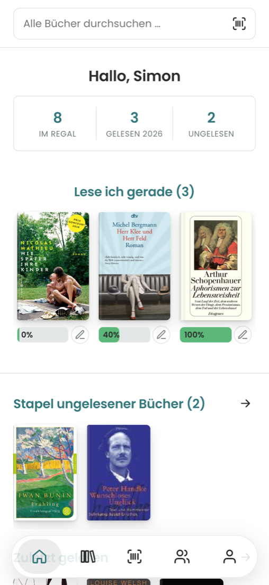
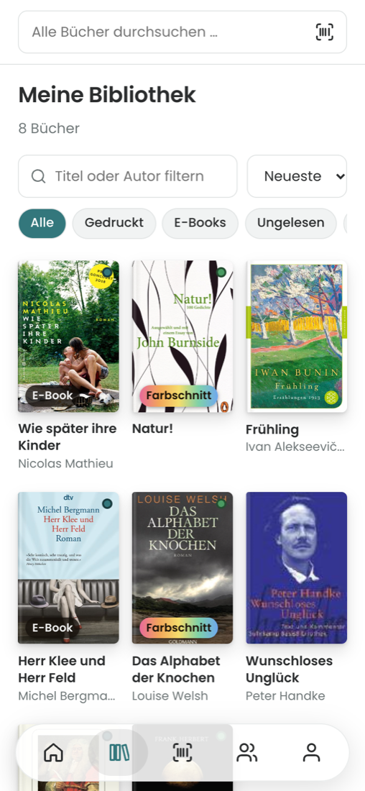
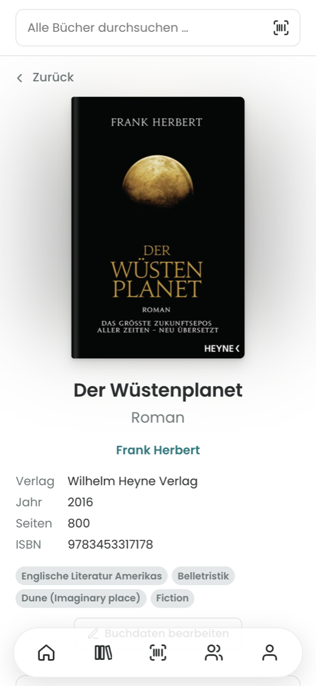
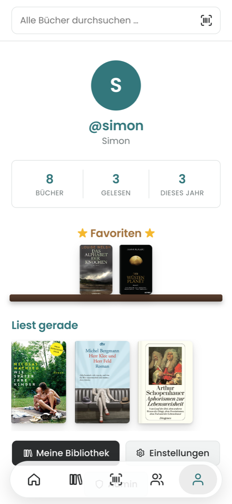
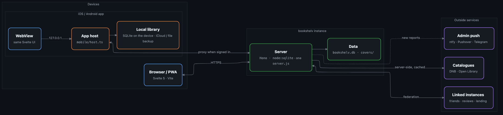

# bookshelv

[English](README.md) · **Deutsch**

Eine kleine, selbst gehostete Bibliotheks-App für den Freundeskreis. Du scannst den Barcode auf der Buchrückseite, das Buch landet mit Cover und Daten in deinem Regal, und von dort aus verfolgst du, was du liest, bewertest es und siehst, wer aus deinem Freundeskreis dasselbe Buch hat – oder es furchtbar fand.

Ich habe sie für meine Frau gebaut. Sie liest viel und hat die meisten Lese-Apps ausprobiert, aber keine passte: zu viel Social-Media-Lärm, überall Tracking und nichts, das die einfache Frage „Wem habe ich das Buch eigentlich geliehen?“ beantwortet. Das hier ist die Version, die wir wirklich wollten – auf unserem eigenen Webspace.

**Status:** live auf [bookshelv.aize-it.de](https://bookshelv.aize-it.de) · iOS im App Store · Android als APK (Play Store folgt) · selbst hostbar · aktive Entwicklung

<p>
  
  
  
  
</p>

## So kommst du dran

| | |
|---|---|
| **iPhone / iPad** | [App Store](https://apps.apple.com/de/app/bookshelv/id6823521958) – funktioniert ohne Konto; mit einer Instanz verbinden kannst du sie jederzeit später |
| **Android** | [APK über GitHub](https://github.com/sgitaize/bookshelv/releases/latest/download/bookshelv.apk) – die App meldet neue Versionen selbst; Play-Store-Version folgt |
| **Browser** | [bookshelv.aize-it.de](https://bookshelv.aize-it.de) oder deine eigene Instanz, als PWA installierbar |
| **Eigener Server** | Docker, Webhosting mit Node.js oder einfach Node – siehe [Selbst hosten](#selbst-hosten) |

## Was sie kann

Bücher hinzufügen soll schnell gehen. Am Handy hältst du die Kamera auf den ISBN-Barcode (oder scannst ein ganzes Regal am Stück, oder direkt auf die Wunschliste; ohne Verbindung merkt sich die App die ISBNs und schlägt sie später nach), und bookshelv sucht das Buch bei der Deutschen Nationalbibliothek (DNB) und Open Library – ist die DNB überlastet, springt der Bibliotheksverbund-Katalog K10plus ein. Du kannst auch nach Titel oder Autor*in suchen oder alles von Hand eintragen, wenn ein Buch in keinem Katalog steht. Zu jedem Exemplar hältst du fest, ob es gedruckt oder ein E-Book ist, Taschenbuch oder gebunden, und ob es einen Farbschnitt hat.

Für jedes Buch gibt es einen Lesestand (ungelesen, lese ich, gelesen, abgebrochen), den Fortschritt in Seiten oder Prozent und die Daten von Beginn und Ende. Lieblingsbücher stehen in einem kleinen Regal auf deinem Profil, dazu eine Top 5 direkt unter deinem Namen. Leselisten funktionieren wie Playlists: „Herbst 26“ oder „Bücher für den Urlaub“ zusammenstellen, umsortieren und privat halten oder mit allen auf der Instanz teilen. Rezensionen mit halben Sternen können Spoiler markieren, Freund*innen können sie kommentieren. Die Startseite zeigt, was du gerade liest, deinen Stapel und was deine Freund*innen machen. Der Aktivitäten-Feed listet, wer welches Buch wann hinzugefügt, begonnen, beendet, bewertet oder auf eine Liste gesetzt hat, und jede Buchseite zeigt ihre eigene Geschichte im Freundeskreis.

Du kommst von einer anderen App? Der Import liest Exporte von Goodreads und StoryGraph direkt, bei allem anderen (Booky, BookBuddy, eine Tabelle) errät er die Spalten und lässt dich korrigieren. Bücher, die du schon hast, werden zusammengeführt statt verdoppelt; weichen Bewertung, Lesestand oder Datum ab, entscheidest du einzeln – oder sagst einmal, dass immer bookshelv oder immer die andere App gewinnt. Booky-Exporte werden direkt erkannt, samt Listen, Lieblingsbüchern und Lesedaten. Jeder Import steht im Import-Verlauf und lässt sich mit einem Tipp rückgängig machen, auch Wochen später. In die andere Richtung exportierst du eine CSV im Goodreads-Format, das fast jede Lese-App importieren kann, im StoryGraph-Format oder als einfache Tabelle.

Die Apps funktionieren **ohne Konto**: Deine Bibliothek liegt auf dem Gerät (SQLite) und wird in deine eigene iCloud oder in eine Datei gesichert. Willst du Freund*innen, Verleih und Rezensionen, verbindest du die App mit einer Instanz; deine lokale Bibliothek wird ohne Dubletten ins Konto übernommen, und alles bleibt offline verfügbar.

Eine Instanz läuft wahlweise nur mit Einladung oder mit offener Registrierung (Einstellung im Admin, mit Obergrenze). Alle können Einladungslinks erstellen, E-Mail-Adressen gibt es nicht – nur Benutzername und Passwort. Im Admin lassen sich Konten sperren oder löschen, Passwörter zurücksetzen, Meldungen prüfen und der Katalog aufräumen.

Standardmäßig sieht die Oberfläche aus wie aus der Schreibmaschine (Courier Prime und Special Elite, beide vom eigenen Server), oder du wechselst auf eine schlichte moderne Schrift. Es gibt sieben Farbthemen, von Nacht und Papier bis Tinte, Wald und Rosé, und die Wahl folgt dir auf jedes Gerät. Die Oberfläche gibt es auf Deutsch und Englisch, dazu native Apps für iOS und Android; die Web-Version lässt sich als PWA installieren.

## Datenschutz

Der Browser spricht nur mit deinem eigenen Server. Katalogsuchen und Cover holt der Server und speichert sie zwischen, sodass DNB und Open Library nie die IP-Adressen deiner Nutzer*innen sehen. Keine externen Schriften, keine CDNs, keine Analyse, kein Tracking. Das einzige Cookie ist das Sitzungs-Cookie, ein Cookie-Banner ist also nicht nötig. Alle können ihre Daten als JSON exportieren und ihr Konto selbst löschen, und jede*r entscheidet selbst, wer das eigene Regal sehen darf.

Betreibst du eine Instanz in Deutschland (oder anderswo mit Impressumspflicht), trag deine Angaben unter Admin → Instanz ein. bookshelv erzeugt daraus unter `/legal` ein Impressum und eine Datenschutzerklärung, die zu dem passen, was die App tatsächlich tut – verlinkt auf der Anmeldeseite und in den Einstellungen. Deine Angaben bleiben in deiner Datenbank und landen nie im Repository.

## Architektur

<p align="center"></p>

<sub>Quelle: <a href="docs/architecture.mmd">docs/architecture.mmd</a> (Mermaid)</sub>

**So funktioniert es**
- **Ein Server, eine Datei.** Das Backend ist Node.js mit [Hono](https://hono.dev) und dem SQLite-Treiber, der bei Node dabei ist (`node:sqlite`, Node 22.13+). esbuild bündelt alles in eine einzige `server.js` ohne `node_modules` – deshalb läuft es auch auf gewöhnlichem Webhosting. Es braucht rund 50 MB RAM und etwa 30 KB Speicher pro Buch für das Cover.
- **Die Oberfläche** ist Svelte 5 mit Vite. Der Barcode-Scan nutzt den BarcodeDetector des Browsers, wo vorhanden, sonst zxing-wasm vom eigenen Server.
- **Die Apps bringen den Server mit.** iOS und Android betten dasselbe Backend über [nodejs-mobile](https://github.com/nodejs-mobile/nodejs-mobile) ein und zeigen die normale Oberfläche in einer WebView. Ohne Konto liefert es eine lokale Bibliothek; angemeldet leitet es an deine Instanz weiter und hält deine Daten für unterwegs vor.
- **Datenschutz eingebaut:** Kataloganfragen und Cover laufen über den Server und werden zwischengespeichert – DNB und Open Library sehen nie die IP-Adressen deiner Nutzer*innen.
- **Instanzen lassen sich verbinden** – für Freundschaften, Rezensionen und Verleih über Servergrenzen hinweg ([docs/FEDERATION.md](docs/FEDERATION.md)).

| Baustein | Ort | Aufgabe |
|---|---|---|
| Server | `server/src/` | API (Hono), Datenbank (`node:sqlite`), Katalogsuche, Föderation, Push |
| Web-App | `web/src/` | Svelte-5-Oberfläche, Übersetzungen in `web/src/lib/locales/` |
| App-Host | `server/src/mobile/host.ts` | lokaler Server, Proxy zur Instanz, Offline-Abgleich, Sicherung |
| SQLite für die Apps | `native/shared/sqlite_napi.c` | `node:sqlite`-Ersatz auf dem System-SQLite (N-API) |
| iOS-App | `native/ios/` | SwiftUI-Hülle, nativer Barcode-Scanner, Trinkgeld |
| Android-App | `native/android/` | Kotlin-/Compose-Hülle, Update-Hinweis |
| Deploy | `deploy/` | Upload per SSH, nur von einem sauberen `main` |
| Tests | `tests/` | API, Oberfläche, Offline und Layout-Prüfung (DE/EN) |

## Selbst hosten

### Docker (Heimserver, Raspberry Pi, VPS)

```bash
git clone https://github.com/sgitaize/bookshelv.git
cd bookshelv
docker compose up -d --build
```

Die App lauscht auf Port 8080 und legt alles in `./data` ab (Datenbank und Cover). Nur diesen Ordner musst du sichern.

Beim ersten Start schreibt bookshelv ein einmaliges Setup-Token, damit niemand anderes das Admin-Konto übernehmen kann:

```bash
cat data/setup-token.txt
```

App öffnen, Token eingeben, Admin-Konto anlegen. Danach lädst du Leute über **Einstellungen → Freunde einladen** ein. Eine angenommene Einladung macht euch zu Freund*innen; alle anderen auf der Instanz findest du unter **Freunde** und kannst ihnen eine Anfrage schicken. Regal, Aktivität, Wunsch- und Leselisten sehen nur Freund*innen; über eine verbundene Instanz fügst du Freund*innen per Adresse hinzu (`@anna@books.example`).

Davor gehört HTTPS. Browser erlauben die Kamera nur über HTTPS, und das Sitzungs-Cookie ist als `Secure` markiert. Mit Caddy zum Beispiel:

```caddy
books.example.org {
    reverse_proxy localhost:8080
}
```

Zum Ausprobieren im Heimnetz ohne HTTPS setzt du `BOOKSHELV_INSECURE_COOKIES: "1"` in `docker-compose.yml`. Anmelden geht dann, Scannen nicht.

### Webhosting mit Node.js (Plesk, z. B. netcup)

Weil das Backend eine einzige Datei ohne Abhängigkeiten ist, brauchst du auf dem Server kein `npm install`.

1. Lokal bauen: `npm install && npm run build`. Das Ergebnis liegt in `dist/`.
2. Den Inhalt von `dist/` in einen Ordner auf dem Webspace laden, z. B. `books.example.org/app/`.
3. In Plesk die Node.js-Einstellungen der Domain öffnen und setzen:
   - Node.js-Version: 22 oder neuer
   - Anwendungsstamm: `/books.example.org/app`
   - Dokumentenstamm: `/books.example.org/app/public`
   - Startdatei der Anwendung: `server.js`
   - Dann Node.js aktivieren. „NPM install“ ist nicht nötig.
4. Ein Let's-Encrypt-Zertifikat für die Domain aktivieren.
5. Das Setup-Token aus `app/data/setup-token.txt` lesen (per SSH oder FTP) und die Seite öffnen.

Für Updates gibt es ein kleines Deploy-Skript, das per SSH hochlädt und die App neu startet. `data/` fasst es nie an:

```bash
cp .env.deploy.example .env.deploy   # Host, Benutzer, Zielordner, SSH-Schlüssel – nicht im Repo
npm run deploy
```

Das Skript deployt nur auf dem Rechner aus `DEPLOY_FROM_HOST` und nur von einem sauberen `main`, der `origin/main` entspricht. Was live ist, ist also immer ein Commit auf GitHub; sein Hash steht in `app/deployed-commit.txt`.

### Einfach Node

```bash
npm install && npm run build
cd dist && node server.js            # Port 3000, Daten in dist/data
```

### Einstellungen

| Variable | Standard | Bedeutung |
|---|---|---|
| `PORT` | `3000` | HTTP-Port (unter Passenger ignoriert) |
| `BOOKSHELV_DATA_DIR` | `./data` | Datenbank, Cover, Setup-Token |
| `BOOKSHELV_PUBLIC_DIR` | `./public` | gebaute Oberfläche |
| `BOOKSHELV_INSECURE_COOKIES` | `0` | `1` erlaubt Anmelden über http (nur zum Testen) |
| `BOOKSHELV_PUSHOVER_TOKEN` | – | Pushover-App-Token für Meldungen an Admins (auch im Admin einstellbar) |
| `BOOKSHELV_TELEGRAM_BOT_TOKEN` | – | Telegram-Bot-Token für Meldungen an Admins (auch im Admin einstellbar) |
| `BOOKSHELV_NTFY_HOSTS` | beliebig | erlaubte ntfy-Server für Meldungen an Admins, kommagetrennt, z. B. `ntfy.sh` |
| `BOOKSHELV_ANDROID_CERTS` | Release-Schlüssel | SHA-256-Fingerabdrücke (kommagetrennt) für `/.well-known/assetlinks.json`, damit Passwortmanager Anmeldungen mit der Android-App teilen. Den Play-App-Signing-Schlüssel ergänzen, sobald die App bei Google Play ist |

### Sicherung

Alles liegt in `data/`: `bookshelv.db` und `covers/`. Eine stimmige Kopie der Datenbank im laufenden Betrieb:

```bash
sqlite3 data/bookshelv.db ".backup data/backup.db"
```

## Entwicklung

```bash
npm install
BOOKSHELV_INSECURE_COOKIES=1 npm run dev   # API auf :3000, Vite auf :5173
```

`server/` enthält das Backend, `web/` die Oberfläche, `deploy/` das Deploy-Skript und `docs/` die Konzepte. Die Übersetzungen liegen in `web/src/lib/locales/`. Für eine neue Sprache `en.ts` kopieren und in `web/src/lib/i18n.svelte.ts` eintragen. Bauen der Apps: [native/README.md](native/README.md).

## Status & Pläne

**Live:** Web · iOS 1.0 im App Store (1.1 in der Prüfung) · Android-APK 1.1 · Play Store folgt.

Bisher fertig: Konten und Einladungen, Admin-Bereich, ISBN-Scan und Katalogsuche, Bibliothek mit Exemplaren (auch E-Book-Shops), Lesefortschritt, Lieblingsbücher, Profile mit Bild, Rezensionen und Kommentare, Verleih mit Rückgabedatum, Archiv für verkaufte oder verschenkte Bücher, Verlauf mit Filtern, Feed, was Freund*innen lesen, Benachrichtigungen in der App, Wunschliste für Freund*innen, Freundschaftsanfragen (auch über verbundene Instanzen), eigene Cover, Top 5 im Profil, Leselisten, Aktivitäten-Feed mit der Geschichte jedes Buchs, Import aus Goodreads, StoryGraph oder beliebiger CSV mit Zusammenführen, Export im Goodreads-/StoryGraph-Format, Lesestatistik mit teilbarem Jahresrückblick, Jahres-Leseziel, erneut gelesen, „Was lese ich als Nächstes?“, Inhaltshinweise (mit ausgeblendeten Covern), Melden und Blockieren mit Benachrichtigung der Admins (Web-Push, ntfy, Pushover oder Telegram), native Apps für iOS und Android ohne Konto (offline, Sicherung in iCloud oder Datei) sowie Deutsch/Englisch.

Getrennte bookshelv-Instanzen lassen sich verbinden, sodass Rezensionen geteilt und Bücher über Instanzen hinweg verliehen werden können. Wie das funktioniert, steht in [docs/FEDERATION.md](docs/FEDERATION.md).

Als Nächstes:

1. Android-App im Google Play Store.
2. bookshelv.de als Standard-Instanz für die Apps.
3. Die Apps auf weiteren Geräten testen (Kamera-Scanner, erster Start) – [#2](https://github.com/sgitaize/bookshelv/issues/2).

Ideen und Fehler gerne als [Issue](https://github.com/sgitaize/bookshelv/issues).

## Datenquellen

Buchdaten kommen von der [Deutschen Nationalbibliothek](https://www.dnb.de/sru) (CC0), dem Verbundkatalog [K10plus](https://wiki.k10plus.de/display/K10PLUS/SRU) (CC0) und [Open Library](https://openlibrary.org/developers/api). Cover kommen von Open Library, ersatzweise vom Cover-Dienst der DNB/MVB.

## Lizenz

[MIT](LICENSE)
